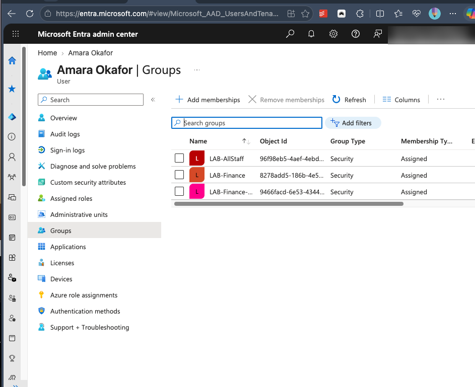
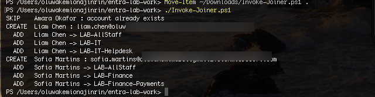
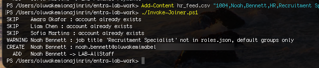
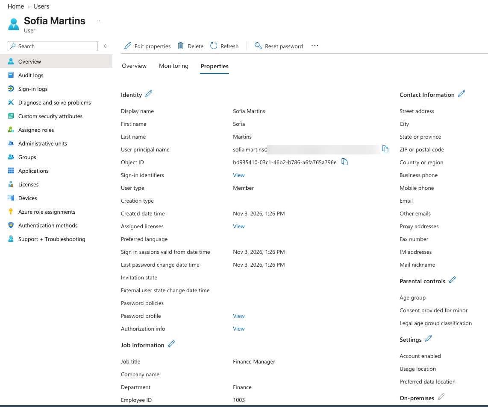
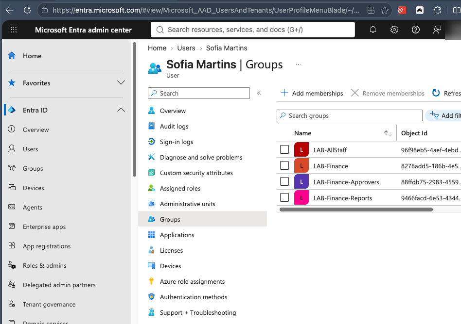
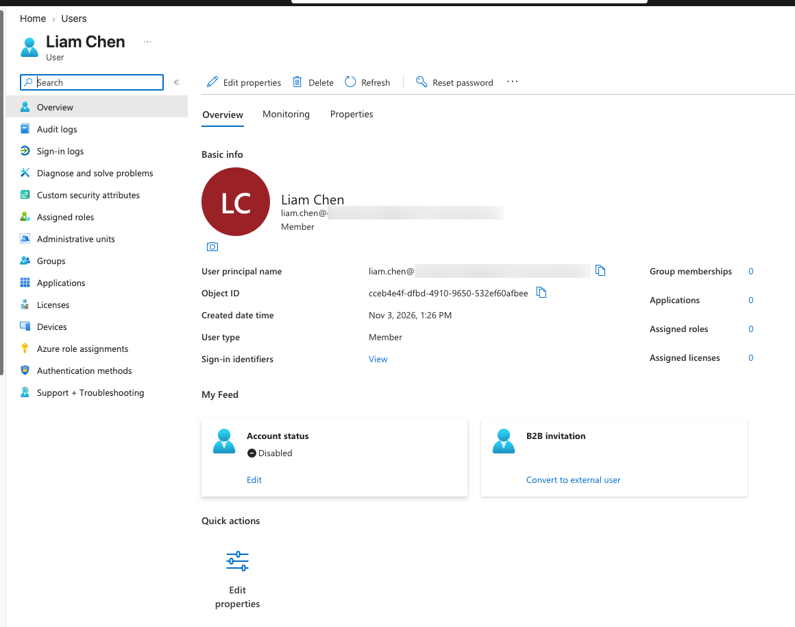
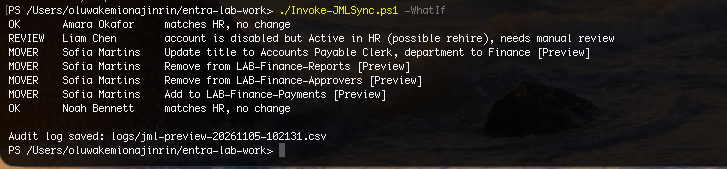

# Entra ID Identity Lifecycle Automation (Joiner / Mover / Leaver)

Automating onboarding, role changes and offboarding in Microsoft Entra ID with PowerShell and Microsoft Graph, built in a personal test tenant.

> Status: in progress. Built in 7 phases; this README is updated as each phase is completed.

## Progress

| Phase | Scope | Status |
|---|---|---|
| 1. Environment setup | Test tenant, PowerShell 7, Graph modules, least-privilege connection | Done |
| 2. RBAC design | Role groups, role-to-group mapping, segregation of duties rule | Done |
| 3. Joiner automation | Create users from an HR feed and assign role groups | Done |
| 4. Mover and leaver automation | Swap access on role change; disable, revoke sessions and remove access on exit; preview mode and audit log | Done |
| 5. Access review | Report memberships; flag over-privileged accounts, disabled accounts with access, and segregation of duties conflicts | Planned |
| 6. MFA and SSO | Enforce MFA and configure SAML 2.0 single sign-on for a test app | Planned |
| 7. Documentation | Offboarding SOP, helpdesk knowledge article, final write-up | Planned |

## Lab environment

| Item | Detail |
|---|---|
| Machine | MacBook Pro, Apple M1 |
| Shell | PowerShell 7.6.9 |
| Identity platform | Microsoft Entra ID (Free license), dedicated test tenant |
| Modules | Microsoft.Graph.Authentication, .Users, .Users.Actions, .Groups (v2.41.2) |
| Automation account | `labadmin`, a cloud-only account holding only the User Administrator role, protected by MFA |

# Phase 1: Environment setup

## Step 1: Test tenant

Created a new Azure free account, which provisions a dedicated Entra ID tenant. A separate tenant keeps all testing away from any real organization's identities.


*Tenant ID and domain blurred.*

## Step 2: PowerShell 7 on macOS

The Homebrew `powershell` cask has been disabled (it failed the macOS Gatekeeper check), so PowerShell was installed from Microsoft's official signed package instead (`powershell-7.6.9-osx-arm64.pkg` from the PowerShell GitHub releases page).

```
$ pwsh --version
PowerShell 7.6.9
```

## Step 3: Microsoft Graph modules

Installed only the Graph submodules this project needs, rather than the full `Microsoft.Graph` bundle, to keep the install small and fast.

```powershell
Install-Module Microsoft.Graph.Authentication, Microsoft.Graph.Users, Microsoft.Graph.Users.Actions, Microsoft.Graph.Groups -Scope CurrentUser
```

```
Name                          Version
----                          -------
Microsoft.Graph.Authentication 2.41.2
Microsoft.Graph.Groups         2.41.2
Microsoft.Graph.Users          2.41.2
Microsoft.Graph.Users.Actions  2.41.2
```

## Step 4: Connect to Microsoft Graph with least privilege

**What:** Signed PowerShell into the test tenant and requested only the permissions this project needs.

**Why:** Microsoft Graph is the API behind Entra ID, so anything done in the portal can be automated through it. Each permission (scope) is requested explicitly, which keeps the session to least privilege:

| Scope | Why it is needed |
|---|---|
| `User.ReadWrite.All` | Create, update and disable user accounts (joiner, mover, leaver) |
| `Group.ReadWrite.All` | Create role groups and change their membership |

No mailbox, directory role or tenant-wide admin scopes were requested. These are **delegated** permissions, so the script acts as the signed-in admin and can never exceed that admin's rights. Admin consent was granted once for the tenant to the *Microsoft Graph Command Line Tools* app.

```powershell
Connect-MgGraph -TenantId "<tenant>.onmicrosoft.com" -Scopes "User.ReadWrite.All","Group.ReadWrite.All" -UseDeviceCode
Get-MgContext | Select-Object Account, TenantId, Scopes
```

```
Account TenantId                             Scopes
------- --------                             ------
        xxxxxxxx-xxxx-xxxx-xxxx-xxxxxxxxxxxx {Group.ReadWrite.All, openid, profile, User.ReadWrite.All}
```

Checking the session context before making changes confirms *which tenant* and *which permissions* the script will run with. Running against the wrong tenant is a common real-world mistake.

# Phase 2: RBAC design

## Step 5: Role-based security groups (RBAC)

**What:** Created seven security groups that represent job roles. Access is granted through group membership, never directly to individuals.

**Why:** Granting access person by person leads to privilege creep (people keep old access when they change jobs) and makes audits slow. With role-based access control, a role maps to a fixed set of groups, so a person gets exactly what their role needs and loses it when the role changes. "Who can approve payments?" is answered by looking at one group.

| Job title | Groups |
|---|---|
| Everyone | LAB-AllStaff |
| Finance Analyst | LAB-Finance, LAB-Finance-Reports |
| Accounts Payable Clerk | LAB-Finance, LAB-Finance-Payments |
| Finance Manager | LAB-Finance, LAB-Finance-Reports, LAB-Finance-Approvers |
| IT Support Analyst | LAB-IT, LAB-IT-Helpdesk |

**Segregation of duties:** `LAB-Finance-Approvers` and `LAB-Finance-Payments` are deliberately separate, so no single person can both make and approve a payment. A later access review step flags anyone who ends up in both.

**Design choices:**
- Security groups (not Microsoft 365 groups), because they are for access, not collaboration. `GroupTypes` is empty, confirming a plain security group.
- `LAB-` naming prefix so it is clear which groups the automation manages.
- A description on every group records its purpose for auditors.
- The creation script ([scripts/New-LabGroups.ps1](scripts/New-LabGroups.ps1)) is **idempotent**: it checks whether each group exists first, so re-running it never creates duplicates.


## Step 6: Role-to-group mapping as configuration

**What:** The RBAC table is stored as data in [config/roles.json](config/roles.json) instead of being written into the scripts.

```json
{
  "defaultGroups": ["LAB-AllStaff"],
  "roles": {
    "Finance Analyst":        ["LAB-Finance", "LAB-Finance-Reports"],
    "Accounts Payable Clerk": ["LAB-Finance", "LAB-Finance-Payments"],
    "Finance Manager":        ["LAB-Finance", "LAB-Finance-Reports", "LAB-Finance-Approvers"],
    "IT Support Analyst":     ["LAB-IT", "LAB-IT-Helpdesk"]
  },
  "segregationOfDuties": [
    ["LAB-Finance-Approvers", "LAB-Finance-Payments"]
  ]
}
```

| Key | Meaning |
|---|---|
| `defaultGroups` | Groups every employee receives, whatever their role |
| `roles` | Job title to the exact groups that role needs |
| `segregationOfDuties` | Pairs of groups one person must never hold together |

A person's access is always `defaultGroups` plus the groups for their job title. For example, a new IT Support Analyst receives LAB-AllStaff, LAB-IT and LAB-IT-Helpdesk, and nothing from Finance.

**Why:** Separating data from code means a new job title is a small, reviewable config change rather than a code change that needs retesting. Access decisions are made once, at the role level, instead of case by case for each person.

# Phase 3: Joiner automation

**Goal:** when HR records a new hire, their account is created automatically with exactly the access their role needs. HR is the source of truth; IT does not create accounts by hand.

## Step 7: Dedicated least-privilege admin account

Before automating, a dedicated cloud-only admin account (`labadmin`) was created and used for all further work instead of the personal Microsoft account that created the tenant.

- **Role: User Administrator, not Global Administrator.** It can create and update users and manage group membership, which is all the automation needs. If it were ever compromised, the damage would be limited to that scope.
- **MFA required.** Security defaults forced MFA registration on first sign-in because the account holds an admin role.
- Its first sign-in required a password change, the same "change at first sign-in" control the joiner script applies to new hires.

## Step 8: The HR feed

[data/hr_feed.csv](data/hr_feed.csv) simulates an export from an HR system.

| Column | Purpose |
|---|---|
| `EmployeeId` | Unique, permanent key. Used to recognise a person on every run; names can be duplicated or change |
| `FirstName`, `LastName` | Display name and sign-in name (`firstname.lastname@tenant`) |
| `Department` | Stored on the account for reporting |
| `JobTitle` | Looked up in `roles.json` to decide group membership |
| `Status` | `Active` or `Terminated`. Phase 3 acts on `Active` only |

## Step 9: Joiner logic, tested by hand first

Each part of the logic was run manually against one person (Amara Okafor) before being automated: looking her up by `employeeId` (no result, so she is a joiner), calculating her groups from `roles.json`, creating her account, adding her to the groups, then verifying membership from the reverse direction (`Get-MgUserMemberOf`).

Graph only returns a default set of properties, so `EmployeeId` and `Department` appeared blank after creation until requested explicitly with `-Property`. The values had been saved correctly.



## Step 10: The joiner script

[scripts/Invoke-Joiner.ps1](scripts/Invoke-Joiner.ps1) runs the same logic for everyone in the feed. For each person:

```
Status Active?                    no  -> skip (leavers are Phase 4)
Account with this EmployeeId?     yes -> skip (not a joiner; safe to re-run)
Groups = defaultGroups + groups for JobTitle
Unknown JobTitle?                 yes -> default groups only, print a warning
Create account (random temporary password, must change at first sign-in)
Add to each group
```

Design choices:
- **Idempotent:** matching on `EmployeeId` means re-running never creates duplicates.
- **Least privilege:** an unknown job title gets only the default group. The script never guesses; missing access gets reported and fixed, while excess access often goes unnoticed.
- **No secrets exposed:** the temporary password is never printed or logged, and the user must replace it at first sign-in, so IT never knows it.

The script reads `roles.json` and `hr_feed.csv` from the folder it is run in.

### Results

First run: Amara (already created by hand) was skipped; Liam and Sofia were created with exactly their role groups. Sofia, an Accounts Payable Clerk, received `LAB-Finance-Payments` but not `LAB-Finance-Approvers`, so segregation of duties holds from day one.



### Edge case: unknown job title

A hire with a job title missing from `roles.json` ("Recruitment Specialist") was added to the feed. The script warned, created the account with the default group only, and skipped the three existing employees.



# Phase 4: Mover and leaver automation

**Goal:** when someone changes role, their access changes to match exactly; when someone leaves, they lose all access immediately. One script handles joiners, movers and leavers, previews every change first, and logs every action.

## Step 11: A new permission, approved by a separate admin

Offboarding needs to sign people out of sessions that are already open, so the Graph scope `User.RevokeSessions.All` was added.

| Scope | Why it is needed |
|---|---|
| `User.RevokeSessions.All` | Sign a leaver out of every device immediately. Disabling an account alone stops new sign-ins, but existing sessions can keep working until their tokens expire |

When `labadmin` requested it, Entra returned **"Need admin approval"**. A User Administrator cannot grant tenant-wide consent to an app, so the Global Administrator approved it once. This separates **using** a permission from **approving** it, so the automation account cannot grant itself new access.

Two checks apply to every delegated call:
- **Consent:** has the app been approved to do this kind of action in the tenant?
- **Role:** is the signed-in person allowed to do it? (`labadmin` already had the right to revoke sessions through User Administrator; consent only opened that action to the script.)

The scope was added only when the work needed it, not up front.

## Step 12: Mover, tested by hand

**Scenario:** Sofia Martins is promoted from Accounts Payable Clerk to Finance Manager.

The mover logic calculates the **minimum change** between what the person has and what their new role allows:

| Current groups | Wanted groups | Action |
|---|---|---|
| LAB-AllStaff | LAB-AllStaff | none |
| LAB-Finance | LAB-Finance | none |
| LAB-Finance-Payments | | **remove** |
| | LAB-Finance-Reports | **add** |
| | LAB-Finance-Approvers | **add** |

Why not remove everything and re-add the new set:
- Groups in both roles are never touched, so there is no access gap.
- A failure halfway leaves the person mostly intact instead of with nothing.
- The audit trail shows only real changes.
- Groups the automation does not manage are never affected.

**Remove before add:** if Approvers were added first, Sofia would briefly hold both `LAB-Finance-Payments` and `LAB-Finance-Approvers`, breaking segregation of duties. Removing first means that never happens.





## Step 13: Leaver, tested by hand

**Scenario:** Liam Chen leaves the company. Three actions, in order:

1. **Disable the account**: no new sign-ins.
2. **Revoke sign-in sessions**: Entra sets a "sessions valid from" time; any token issued before it is rejected, so every device is signed out.
3. **Remove all managed groups**: if the account were ever re-enabled by mistake, it would have no access.

The account is **disabled, not deleted**, so files can be recovered and auditors can still see who had what. Deletion is a separate, deliberate step after a retention period.



## Step 14: The lifecycle script

[scripts/Invoke-JMLSync.ps1](scripts/Invoke-JMLSync.ps1) compares the HR feed with Entra ID and acts only on the difference.

```
For each person in the HR feed (matched by EmployeeId):
  Terminated  -> already disabled with no managed groups? skip
                 otherwise disable, revoke sessions, remove managed groups
  No account  -> joiner: create account, add role groups
  Disabled but Active in HR -> flag for manual review (possible rehire), change nothing
  Otherwise   -> mover: update title/department if changed,
                 remove groups no longer needed, then add new ones
```

Safety features:
- **Preview mode (`-WhatIf`)**: shows every planned change without making it.
- **Audit log**: every action is written to a timestamped CSV with the employee ID, action and result.
- **Managed groups only**: the script builds its list of managed groups from `roles.json` and never adds or removes any other group.
- **Rehire guard**: a disabled account is never silently re-enabled.
- **Idempotent**: running it again with the same feed makes no changes.

## Step 15: Preview caught a bad change

The first preview ran against an HR file that had not been updated. It planned to move Sofia back to Accounts Payable Clerk, undoing her promotion, and flagged Liam (disabled, but Active in the stale file) for manual review rather than re-enabling him.



Because it was a preview, nothing changed. The HR file was corrected ([data/hr_feed_phase4.csv](data/hr_feed_phase4.csv)) and the preview re-run. The script trusts HR as the source of truth, so a data problem is fixed at the source, not in Entra.

## Step 16: Apply, audit and re-run

After reviewing the corrected preview, the sync was applied:

```
MOVER    Amara Okafor     Update title to IT Support Analyst, department to IT [Success]
MOVER    Amara Okafor     Remove from LAB-Finance [Success]
MOVER    Amara Okafor     Remove from LAB-Finance-Reports [Success]
MOVER    Amara Okafor     Add to LAB-IT [Success]
MOVER    Amara Okafor     Add to LAB-IT-Helpdesk [Success]
OK       Liam Chen        already offboarded
OK       Sofia Martins    matches HR, no change
LEAVER   Noah Bennett     Disable account [Success]
LEAVER   Noah Bennett     Revoke sign-in sessions [Success]
LEAVER   Noah Bennett     Remove from LAB-AllStaff [Success]
```

Audit log (`logs/jml-applied-*.csv`):

```
Timestamp           Type   EmployeeId Name         Action                                               Result
2026-11-05 10:26:29 MOVER  1001       Amara Okafor Update title to IT Support Analyst, department to IT Success
2026-11-05 10:26:29 MOVER  1001       Amara Okafor Remove from LAB-Finance                              Success
2026-11-05 10:26:30 MOVER  1001       Amara Okafor Remove from LAB-Finance-Reports                      Success
2026-11-05 10:26:30 MOVER  1001       Amara Okafor Add to LAB-IT                                        Success
2026-11-05 10:26:31 MOVER  1001       Amara Okafor Add to LAB-IT-Helpdesk                               Success
2026-11-05 10:26:32 LEAVER 1004       Noah Bennett Disable account                                      Success
2026-11-05 10:26:33 LEAVER 1004       Noah Bennett Revoke sign-in sessions                              Success
2026-11-05 10:26:33 LEAVER 1004       Noah Bennett Remove from LAB-AllStaff                             Success
```

Only real changes are logged. Running the sync again with the same feed made no changes:

```
OK       Amara Okafor     matches HR, no change
OK       Liam Chen        already offboarded
OK       Sofia Martins    matches HR, no change
OK       Noah Bennett     already offboarded

No changes needed.
```

## Troubleshooting log

| Problem | Cause | Fix |
|---|---|---|
| `brew install --cask powershell` failed: "No Cask with this name exists" | Homebrew disabled the cask after it failed the macOS Gatekeeper check | Installed the signed `osx-arm64.pkg` from the official PowerShell releases page |
| "Untrusted repository" prompt during `Install-Module` | PSGallery is not trusted by default | Confirmed it is Microsoft's official gallery and accepted (A) |
| `Connect-MgGraph` returned with no output and `Get-MgContext` was empty | No `-TenantId` was given, so the personal admin account was not routed to the tenant and the sign-in failed silently (confirmed later when browser sign-in worked once `-TenantId` was added) | Added `-TenantId` |
| `$Error[0]` showed "Access to the path '/usr/local/share/powershell' is denied" | Unrelated: PowerShellGet tried to create an all-users folder during the earlier install. Modules were installed per-user, so it had no effect | Identified as noise, not the root cause |
| Device code sign-in failed with "The code you entered has expired" on login.live.com | The tenant admin is a personal Microsoft account. Without a tenant specified, sign-in was routed to the consumer endpoint, which did not recognize the work-tenant code | Added `-TenantId` so sign-in went to login.microsoftonline.com for this tenant |
| "Authentication timed out after 120 seconds" | Sign-in plus the first-time consent screen took longer than PowerShell's 120-second wait | Re-ran; consent was already stored, so sign-in completed quickly |

| `Get-MgUser` failed with "DeviceCodeCredential authentication failed" the next day | The saved session's access token had expired. Tokens are short-lived by design | `Disconnect-MgGraph`, then signed in again |
| Device code sign-in as `labadmin` blocked with error 530035 | Security defaults blocked device code flow for an account holding an admin role. Device code flow is commonly abused in phishing | Used standard browser sign-in with `-TenantId` instead of turning off security defaults |
| `EmployeeId` and `Department` blank after `New-MgUser` | Graph returns only default properties | Requested them explicitly with `-Property`; the values were saved correctly |
| "Need admin approval" when `labadmin` requested `User.RevokeSessions.All` | User Administrator cannot grant tenant-wide consent for a new app permission | Global Administrator granted admin consent once; `labadmin` then signed in without the prompt |
| First sync preview planned to undo a promotion | The HR file had not been updated, and the script treats HR as the source of truth | Caught in preview mode before any change; corrected the HR file and re-ran |

## Improvements noted
- ~~Use a dedicated cloud-only admin account instead of a personal Microsoft account~~ Done in Phase 3 (`labadmin`, User Administrator only).
- Generate temporary passwords with a cryptographic random generator in a production version.
- Read the HR feed from the HR system's API instead of a CSV, and run the sync on a schedule.
- Look up group IDs once per run instead of once per change, to reduce Graph calls.
