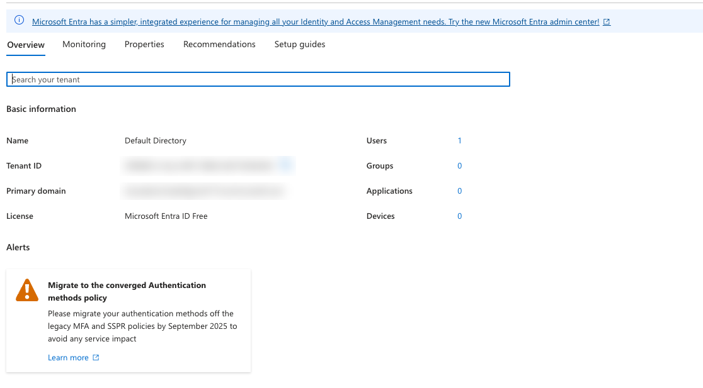
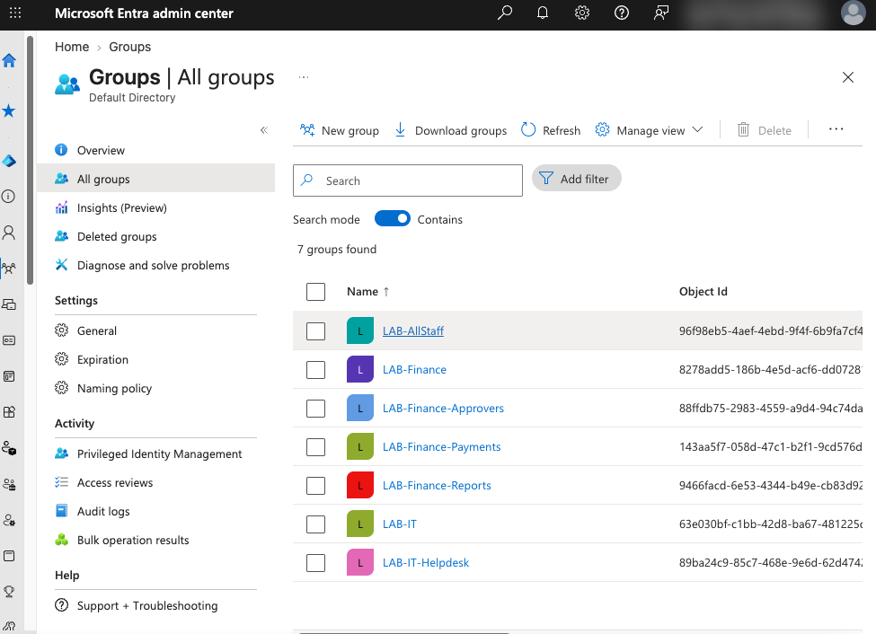

# Entra ID Identity Lifecycle Automation (Joiner / Mover / Leaver)

Automating onboarding, role changes and offboarding in Microsoft Entra ID with PowerShell and Microsoft Graph, built in a personal test tenant.

> Status: in progress. Built in 7 phases; this README is updated as each phase is completed.

## Progress

| Phase | Scope | Status |
|---|---|---|
| 1. Environment setup | Test tenant, PowerShell 7, Graph modules, least-privilege connection | Done |
| 2. RBAC design | Role groups, role-to-group mapping, segregation of duties rule | Done |
| 3. Joiner automation | Create users from an HR feed and assign role groups | Planned |
| 4. Mover and leaver automation | Swap access on role change; disable, revoke sessions and remove access on exit; preview mode and audit log | Planned |
| 5. Access review | Report memberships; flag over-privileged accounts, disabled accounts with access, and segregation of duties conflicts | Planned |
| 6. MFA and SSO | Enforce MFA and configure SAML 2.0 single sign-on for a test app | Planned |
| 7. Documentation | Offboarding SOP, helpdesk knowledge article, final write-up | Planned |

## Lab environment

| Item | Detail |
|---|---|
| Machine | MacBook Pro, Apple M1 |
| Shell | PowerShell 7.6.9 |
| Identity platform | Microsoft Entra ID (Free license), dedicated test tenant |
| Modules | Microsoft.Graph.Authentication, .Users, .Users.Actions, .Groups (v2.41.2) |

# Phase 1: Environment setup

## Step 1: Test tenant

Created a new Azure free account, which provisions a dedicated Entra ID tenant. A separate tenant keeps all testing away from any real organization's identities.


*Tenant ID and domain blurred.*

## Step 2: PowerShell 7 on macOS

The Homebrew `powershell` cask has been disabled (it failed the macOS Gatekeeper check), so PowerShell was installed from Microsoft's official signed package instead (`powershell-7.6.9-osx-arm64.pkg` from the PowerShell GitHub releases page).

```
$ pwsh --version
PowerShell 7.6.9
```

## Step 3: Microsoft Graph modules

Installed only the Graph submodules this project needs, rather than the full `Microsoft.Graph` bundle, to keep the install small and fast.

```powershell
Install-Module Microsoft.Graph.Authentication, Microsoft.Graph.Users, Microsoft.Graph.Users.Actions, Microsoft.Graph.Groups -Scope CurrentUser
```

```
Name                          Version
----                          -------
Microsoft.Graph.Authentication 2.41.2
Microsoft.Graph.Groups         2.41.2
Microsoft.Graph.Users          2.41.2
Microsoft.Graph.Users.Actions  2.41.2
```

## Step 4: Connect to Microsoft Graph with least privilege

**What:** Signed PowerShell into the test tenant and requested only the permissions this project needs.

**Why:** Microsoft Graph is the API behind Entra ID, so anything done in the portal can be automated through it. Each permission (scope) is requested explicitly, which keeps the session to least privilege:

| Scope | Why it is needed |
|---|---|
| `User.ReadWrite.All` | Create, update and disable user accounts (joiner, mover, leaver) |
| `Group.ReadWrite.All` | Create role groups and change their membership |

No mailbox, directory role or tenant-wide admin scopes were requested. These are **delegated** permissions, so the script acts as the signed-in admin and can never exceed that admin's rights. Admin consent was granted once for the tenant to the *Microsoft Graph Command Line Tools* app.

```powershell
Connect-MgGraph -TenantId "<tenant>.onmicrosoft.com" -Scopes "User.ReadWrite.All","Group.ReadWrite.All" -UseDeviceCode
Get-MgContext | Select-Object Account, TenantId, Scopes
```

```
Account TenantId                             Scopes
------- --------                             ------
        xxxxxxxx-xxxx-xxxx-xxxx-xxxxxxxxxxxx {Group.ReadWrite.All, openid, profile, User.ReadWrite.All}
```

Checking the session context before making changes confirms *which tenant* and *which permissions* the script will run with. Running against the wrong tenant is a common real-world mistake.

# Phase 2: RBAC design

## Step 5: Role-based security groups (RBAC)

**What:** Created seven security groups that represent job roles. Access is granted through group membership, never directly to individuals.

**Why:** Granting access person by person leads to privilege creep (people keep old access when they change jobs) and makes audits slow. With role-based access control, a role maps to a fixed set of groups, so a person gets exactly what their role needs and loses it when the role changes. "Who can approve payments?" is answered by looking at one group.

| Job title | Groups |
|---|---|
| Everyone | LAB-AllStaff |
| Finance Analyst | LAB-Finance, LAB-Finance-Reports |
| Accounts Payable Clerk | LAB-Finance, LAB-Finance-Payments |
| Finance Manager | LAB-Finance, LAB-Finance-Reports, LAB-Finance-Approvers |
| IT Support Analyst | LAB-IT, LAB-IT-Helpdesk |

**Segregation of duties:** `LAB-Finance-Approvers` and `LAB-Finance-Payments` are deliberately separate, so no single person can both make and approve a payment. A later access review step flags anyone who ends up in both.

**Design choices:**
- Security groups (not Microsoft 365 groups), because they are for access, not collaboration. `GroupTypes` is empty, confirming a plain security group.
- `LAB-` naming prefix so it is clear which groups the automation manages.
- A description on every group records its purpose for auditors.
- The creation script ([scripts/New-LabGroups.ps1](scripts/New-LabGroups.ps1)) is **idempotent**: it checks whether each group exists first, so re-running it never creates duplicates.



## Step 6: Role-to-group mapping as configuration

**What:** The RBAC table is stored as data in [config/roles.json](config/roles.json) instead of being written into the scripts.

```json
{
  "defaultGroups": ["LAB-AllStaff"],
  "roles": {
    "Finance Analyst":        ["LAB-Finance", "LAB-Finance-Reports"],
    "Accounts Payable Clerk": ["LAB-Finance", "LAB-Finance-Payments"],
    "Finance Manager":        ["LAB-Finance", "LAB-Finance-Reports", "LAB-Finance-Approvers"],
    "IT Support Analyst":     ["LAB-IT", "LAB-IT-Helpdesk"]
  },
  "segregationOfDuties": [
    ["LAB-Finance-Approvers", "LAB-Finance-Payments"]
  ]
}
```

| Key | Meaning |
|---|---|
| `defaultGroups` | Groups every employee receives, whatever their role |
| `roles` | Job title to the exact groups that role needs |
| `segregationOfDuties` | Pairs of groups one person must never hold together |

A person's access is always `defaultGroups` plus the groups for their job title. For example, a new IT Support Analyst receives LAB-AllStaff, LAB-IT and LAB-IT-Helpdesk, and nothing from Finance.

**Why:** Separating data from code means a new job title is a small, reviewable config change rather than a code change that needs retesting. Access decisions are made once, at the role level, instead of case by case for each person.

## Troubleshooting log

| Problem | Cause | Fix |
|---|---|---|
| `brew install --cask powershell` failed: "No Cask with this name exists" | Homebrew disabled the cask after it failed the macOS Gatekeeper check | Installed the signed `osx-arm64.pkg` from the official PowerShell releases page |
| "Untrusted repository" prompt during `Install-Module` | PSGallery is not trusted by default | Confirmed it is Microsoft's official gallery and accepted (A) |
| `Connect-MgGraph` returned with no output and `Get-MgContext` was empty | The interactive browser sign-in never launched on macOS, and the failure was silent | Switched to device code flow (`-UseDeviceCode`) |
| `$Error[0]` showed "Access to the path '/usr/local/share/powershell' is denied" | Unrelated: PowerShellGet tried to create an all-users folder during the earlier install. Modules were installed per-user, so it had no effect | Identified as noise, not the root cause |
| Device code sign-in failed with "The code you entered has expired" on login.live.com | The tenant admin is a personal Microsoft account. Without a tenant specified, sign-in was routed to the consumer endpoint, which did not recognize the work-tenant code | Added `-TenantId` so sign-in went to login.microsoftonline.com for this tenant |
| "Authentication timed out after 120 seconds" | Sign-in plus the first-time consent screen took longer than PowerShell's 120-second wait | Re-ran; consent was already stored, so sign-in completed quickly |

## Improvements noted
- Create a dedicated cloud-only admin account in the tenant instead of using a personal Microsoft account as admin (the `Account` field is blank for the personal account, and separating admin identities from everyday ones is standard practice).

